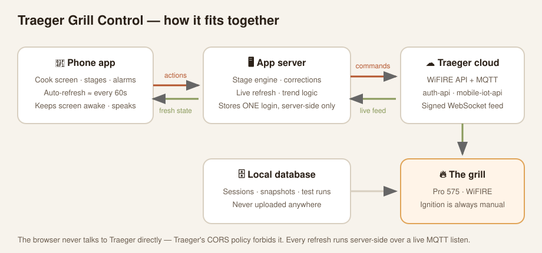
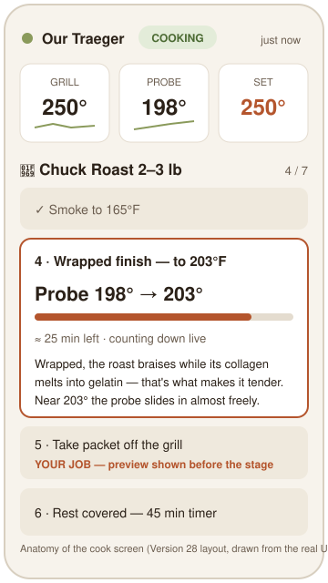
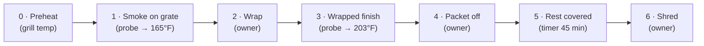
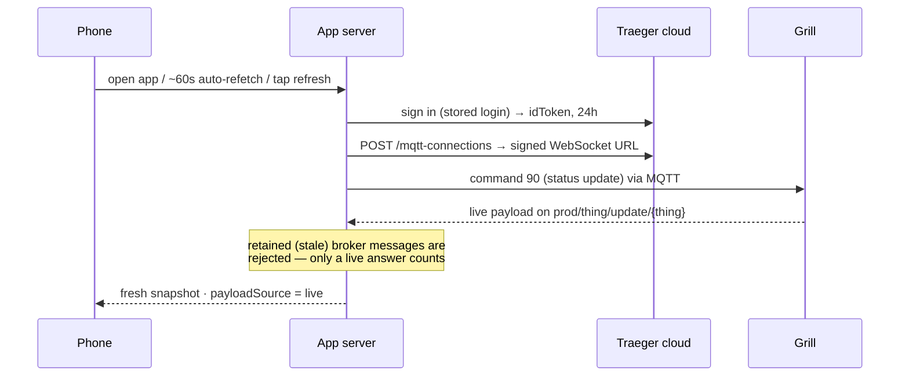

# Traeger Grill Control

**A recipe-driven control app for a WiFIRE Traeger grill — it doesn't just watch the grill, it runs the cook.**

Pick a cut of meat, ignite the grill (the one thing that is always manual), and the app walks the cook stage by stage: it holds the grill at the stage's temperature, tracks the probe, works out time-left from the meat's *actual* rise rate, advances stages by itself when their condition is met, and — when a stage needs *you* — sounds a siren and **speaks the instruction out loud** until you acknowledge it.

   



---

## Why this exists

The official Traeger app shows temperatures. It does not run a recipe: it won't hold a stage plan, won't tell you *why* you're waiting for a temperature, won't keep fresh data in front of you while the phone sits on the counter, and won't shout at you when it's time to wrap. This app was built in a single day (Nov 7, 2026 — 28 shipped versions) around one real cook, and every bug found during that cook became a written business rule plus an automated test.

## What it does

- **10 cooking programs** — Filet Mignon, Ribeye, Flat Iron, Tri‑Tip, Salmon, Whole Chicken, Brisket, Pulled Pork, Ribs 3‑2‑1, Chuck Roast — steaks as reverse-sear, each program a stage plan with per-meat shopping/prep lists.
- **Stage engine** — every stage completes one of four ways: `owner` (you tap Done), `probe` (target internal temp), `timer`, or `grilltemp` (preheat). Monitored stages advance **automatically** the moment their condition is met; the Done button exists only on stages that are genuinely yours.
- **The recipe drives the grill** — the active stage's temperature *is* the grill's target. If the setpoint drifts, the app requests a correction, executes it, and confirms it against the grill's own next report.
- **Live time-left** — computed from the current stage's probe rise rate only (trailing 10-minute window), ticking down every second between updates. A stalled probe reads as an honest *stall*, never a fake countdown.
- **Spoken alarms** — siren + text-to-speech of the stage's exact instruction, repeating until acknowledged. Acknowledgements persist server-side; if the grill's own data proves you already did the step, the alarm auto-acknowledges.
- **Trends with judgement** — sparkline arrows are colored by *expectation*, not raw direction: inside the setpoint band is flat green; moving toward the setpoint is green (even a green *down* arrow above it); moving away is red.
- **Why-lines** — every stage of every program carries one short line explaining what is physically happening to the meat and why that target is the target. Numbers live in the tiles; the line teaches.
- **One meaning, one place** — screens are deliberately minimal; no fact or instruction is rendered twice.
- **Keep-awake** — the cook screen holds the phone awake during a cook and re-arms itself after reloads and background trips; the header only ever claims "awake" while a mechanism is actually live.
- **Honest freshness** — a checked-age label that can never be faked ("just now" → "N min ago"), a single refresh indicator, and layout that doesn't move while refreshing.



## How a cook flows



*The Chuck Roast program, as cooked on day one. Owner stages show their instruction **before** the stage (preview on the upcoming row) and remove it from the card once the stage is underway — instructions arrive before, not during.*

## How live data reaches the screen

Traeger's cloud cannot be called from a browser — its CORS policy allowlists only `traeger.com` (verified by direct probing). So every refresh is a server-side live listen:



The hardest bug of the day lives here: in the hosted runtime, a raw WebSocket bypassed the required egress proxy and its TLS handshake died in 2–18 ms — which the app initially misreported as a "12 s timeout." Version 26 moved the broker exchange into a raw-socket worker (proxy CONNECT → TLS → upgrade → hand-rolled MQTT framing) and made the timing record name the exact failing stage. Since then, refresh is verified working in production, and test T65 pins the failure-stage mapping so the fake-timeout class of bug cannot return silently.

## Business rules & the test suite

The app carries its own **Spec & Tests** view: 14 business requirements (R1–R14) and an automated end-to-end suite — **78 scenarios, all passing** — that runs against the live app. The shipping rule is absolute: *a change without tests, or with a red suite, does not ship.* Anything that genuinely cannot be automated in a sandbox (the phone's screen actually staying on, sound actually coming out of an iPhone speaker, the visible scroll landing) is registered as an explicit **manual-verification item** — never silently untested, never fake-passed.

| Rule | In one line |
|---|---|
| R1 | Real grill state rules everything — no timer or progress while the grill isn't actually cooking |
| R2 | The recipe drives the grill: drift → correction → confirmed on the grill's own report |
| R3 | Stages advance by their completion type; monitored stages auto-advance; time-left from current-stage data only |
| R4 | Alarm discipline: siren + spoken instruction until acknowledged; acks persist; reality auto-acks |
| R5 | Minimal UI, one meaning in one place, age label never falsified |
| R6 | Honest refresh: direct-to-API only, ~60 s auto-refetch while open, single indicator, no layout jumps |
| R7 | Trends: expectation-colored sparklines with a setpoint reference while cooking |
| R8 | Continuity: sessions survive restarts and rebuilds; ranges enforced; password never reaches the client |
| R9 | No way out mid-cook except finishing or a confirmed Shutdown |
| R10 | Instruction lifecycle: preview before, alarm at the transition, gone once underway; stage lines teach, not repeat |
| R11 | Every feature ships with automated E2E tests — red suite, no ship |
| R12 | History opens with the app itself: version, build time, test status, last 3 releases' notes |
| R13 | Build recovery: the client detects a newer build and reloads itself exactly once |
| R14 | Server response contracts: every action's shape is asserted on success **and** rejection paths |

## WiFIRE protocol notes (reverse-engineered, verified live)

Traeger publishes no API. The current ("v2") cloud, worked out from community Home Assistant forks and verified against a live grill:

- **Auth:** `POST https://auth-api.iot.traegergrills.io/tokens` with `{username, password}` → flat `{idToken, expiresIn: 86400}`. (Fallback: Cognito `USER_PASSWORD_AUTH`, client `4id473dsrcq4kevlgrikukqn2a`.)
- **API base:** `https://mobile-iot-api.iot.traegergrills.io` — `GET /users/self` lists your grills ("things"); `POST /things/{thingName}/commands` sends a command; `POST /mqtt-connections` returns a signed AWS IoT WebSocket URL; subscribe to `prod/thing/update/{thingName}`.
- **Header:** raw `authorization: <idToken>`.
- **Commands:** `90` status update · `11,{tempF}` set grill temp · `120,10,{sensor_id},{tempF}` probe target · `12,{seconds}` timer · `13` timer reset · `17` shutdown. **There is no ignite command — ignition is always manual.**
- **system_status:** `99` offline · `3` idle · `5` igniting · `6` cooking.
- The old v1 cloud (client `2fuohjtqv1e63dckp5v84rau0j`) is dead — it returns `ResourceNotFoundException`.

## Project layout

```
client/src/          Phone-first React UI (cook view, stage sheets, history, spec & tests)
server/src/
  actions.ts         All published actions (dashboards, live refresh, cook lifecycle, sign-in)
  privileged.ts      Raw-socket MQTT worker: proxy CONNECT → TLS → WS → MQTT framing
  integrationTests.ts  The 78-scenario E2E suite (runs in-app)
  schema.ts          Database schema
drizzle/             SQL migrations 0001–0011
DATA-PLAN.md         Data model and storage plan
tools/               The standalone Python WiFIRE toolkit the app grew out of:
  traeger_client.py    v2 cloud client — auth, grill discovery, commands (read-only
                       by default; state-changing commands require --confirm)
  monitor.py           Live cook monitor: streams MQTT state, holds the recipe's
                       setpoint, fires an event when the probe crosses its target
  run_once.py          One-shot read-only grill state check
  auth_diag.py         Single-attempt auth diagnostic (never prints the secret)
  cors-probe-report.md The measured CORS probe behind the server-side design
  Credentials reach these scripts only via stdin or local environment variables —
  never argv, never files, never logs.
```

## Security model

- The Traeger login is stored **server-side only**, at the owner's explicit instruction, and is **never** returned to the client after entry — the suite asserts the password appears in no action response.
- The 24 h token is cached and auto-renewed from the stored login; a rejected login surfaces an honest `auth_failed` state instead of looping.
- The app's database (sessions, snapshots, the stored login) is **not in this repository** and is never uploaded anywhere.
- This is a personal, single-tenant app: one grill, one account. Sharing it with another Traeger owner means a separate multi-tenant build — the code here would show them *this* grill.

## Not in this repo

- `app.db` — the live database (see above).
- `client/src/assets/keepawake-loop.mp4` — the silent looping video behind the keep-awake fallback. The upload path used for this repo accepts text files only; add it with a regular `git push` if you clone.
- Build outputs, `node_modules`, and platform caches.

## Status & history

Built and cooked with on Nov 7, 2026. First cook **completed the same day**: a 2–3 lb chuck roast at 250 °F — smoked on the grate, wrapped in foil with onions at 165 °F, finished probe-tender at 203 °F, rested 45 minutes, shredded. Recent milestones: **v26** live refresh fixed in production (raw-socket MQTT worker) · **v27** live-ticking countdown from current-stage data + scroll-to-current-stage + band-first trends · **v28** automatic ~60 s refetch while open, legacy "ask the assistant to check" path removed, self-healing keep-awake, speech unlock, one-meaning-one-place UI pass, why-lines on all 56 stages.

**Known gap found by the first cook (fix designed, not yet built):** the in-app Shutdown button *records* a shutdown request but has no executor — nothing sends the real command (`17`), so the grill kept cooking until the command was sent from the Python toolkit. Next version: the button executes directly via the app's stored login after the existing warning confirmation; when the final stage completes, Shutdown becomes the primary action (still never automatic — a resting cook may want the grill warm); and the grill's shutdown/cooling state (`system_status` 8) joins the state map.

*Unofficial personal project. Not affiliated with Traeger, Inc. Use of Traeger's cloud is via the same interfaces as the official app; Traeger's terms may restrict automated access — run it on your own account, at your own judgement.*
